# Cápsula endoscópica sem fio: sistema de imagem

**TCC em Engenharia de Controle e Automação, UFRGS (2025)**: *Validação de Conceito para Sistema de Transmissão de Imagens para Cápsula Endoscópica sem Fios*


Protótipo de bancada do caminho completo da imagem numa cápsula endoscópica:
**câmera → microcontrolador → compressão → rádio → reconstrução**. Usa
hardware de baixo custo com as mesmas restrições de uma cápsula real: 8 kB
de RAM e um rádio de 32 bytes por pacote.

<table>
<tr>
<td width="46%">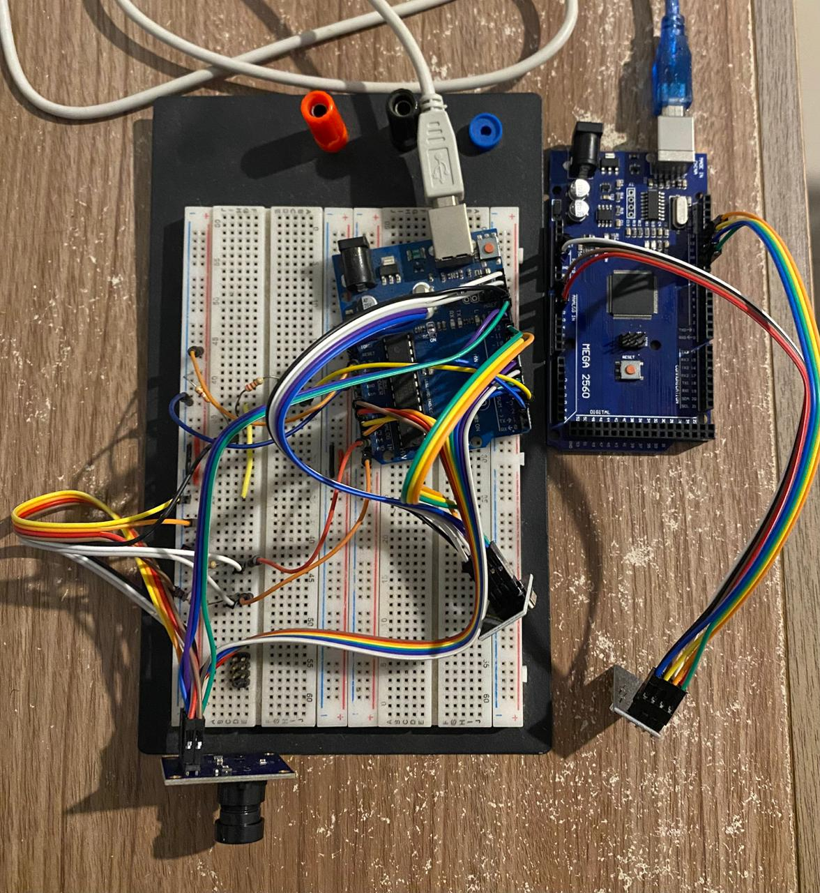</td>
<td>

| Resultado (bancada) | |
|---|---|
| Pacotes entregues a 1 m | **97,4%** |
| Pacotes entregues a 3 m | **94,1%** |
| Dados por quadro com RLE | **−34,4%** |
| Quadros por segundo com RLE | **+50,8%** |

OV7670 · Arduino Mega 2560 · nRF24L01+ · Arduino Uno · Python

</td>
</tr>
</table>

> **English:** bench prototype of a wireless capsule endoscope imaging chain.
> An OV7670 camera is read by an Arduino Mega, line by line. Each line is
> optionally compressed (RLE or DPCM + Golomb-Rice) and sent in 32-byte
> nRF24L01+ packets with a custom protocol (sequence numbers, line/frame
> markers, CRC-8). A Python tool rebuilds the frames even with lost,
> duplicated or reordered packets.

---

## Como funciona

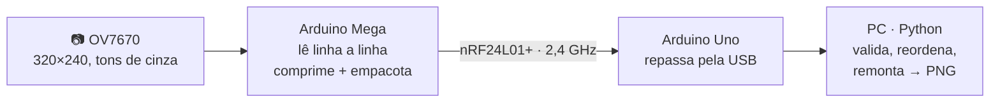

**1. Captura sem buffer de quadro.** Uma imagem tem 76,8 kB e o Mega tem
8 kB de RAM. Por isso o firmware lê uma linha, transmite e pega a próxima
linha que ainda falta.

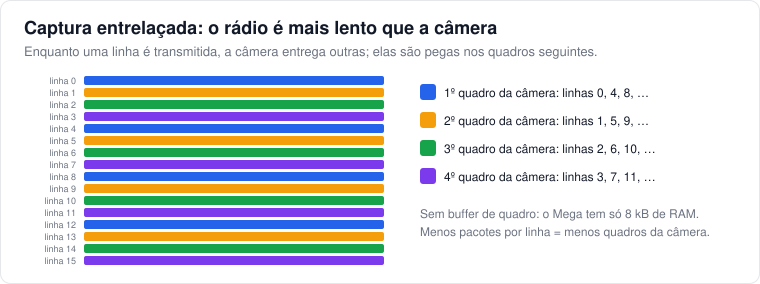

**2. Pacotes de 32 bytes.** Cada linha começa num pacote novo, então uma
perda afeta só aquela linha.

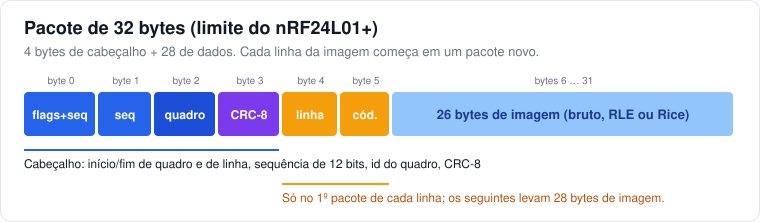

**3. Compressão por linha.** O firmware envia cada linha na menor forma entre
bruta, RLE e, opcionalmente, DPCM + Rice.

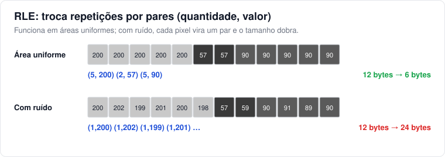

Detalhes: [protocolo](docs/protocolo.md) · [hardware e ligações](docs/hardware.md) · [compressão](docs/compressao.md)

---

## Resultados: as 4 etapas de validação

Cada etapa acrescenta uma camada e isola uma variável. Todas podem ser
reproduzidas com `#define ETAPA 1..4` no firmware.

### Etapa 1: leitura da câmera

Quadros enviados crus pela USB, sem protocolo nem rádio. A leitura do
barramento paralelo funcionou, com ~1,55 s por quadro (limite da serial).

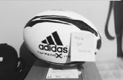

### Etapa 2: protocolo de pacotes

Os pacotes foram enviados pela USB com perdas e trocas de ordem artificiais.
Com até **5% de perda**, a imagem continua inteira, só com falhas
localizadas nos trechos perdidos.

| Captura real com perdas | Simulação: 0% · 2% · 5% de perda |
|:---:|:---:|
| 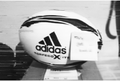 | 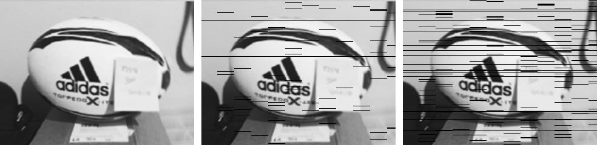 |

### Etapa 3: enlace sem fio

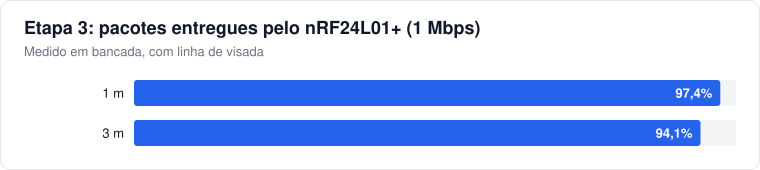

### Etapa 4: compressão RLE

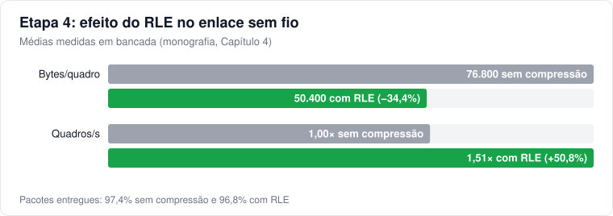


*Mesma cena recebida sem compressão (esquerda) e com RLE (direita).*

---

## Além do TCC: qual compressão usar?

O RLE só reduz linhas com áreas uniformes. Com ruído de sensor, cada pixel
vira um par e a linha volta a ser enviada bruta. Para comparar alternativas
que caibam num microcontrolador, o mesmo protocolo foi simulado com outros
algoritmos sem perdas:

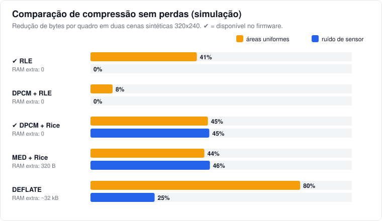

**DPCM + Golomb-Rice** reduz ~45% nos dois cenários, sem RAM extra. Já vem
implementado no firmware: basta ativar `#define COMPRESSAO COMP_RICE`. Os
valores são de simulação ([metodologia](docs/compressao.md)).

---

## Rode você mesmo

**Sem hardware** (Python 3.9+, sem dependências):

```bash
cd software
```

```bash
python -m capsula.simular --saida demo.bin --quadros 2 --perda 0.03 --duplicar 0.005 --reordenar 0.01
```

```bash
python -m capsula.receber --arquivo demo.bin
```

```
Quadro   0: 1736/1782 pacotes (97.4%), linhas 200 completas / 31 parciais / 9 faltantes, RLE/Rice em 231/0 linhas (39.8% menor), 8 duplicados -> quadro_0001.png
```

Outros comandos: `python -m capsula.compressao` (tabela de compressão) e
`python -m unittest discover -s tests` (testes).

**Com hardware** ([lista de materiais e ligações](docs/hardware.md)):

| `ETAPA` em `config.h` | Placas | No PC |
|---|---|---|
| 1 | Mega pela USB | `python -m capsula.receber --porta COM3 --bruto` |
| 2 | Mega pela USB | `python -m capsula.receber --porta COM3` |
| 3 e 4 | Mega + rádio → Uno pela USB | `python -m capsula.receber --porta COM5 --csv metricas.csv` |

Passo a passo de gravação e diagnóstico: [`firmware/README.md`](firmware/README.md).

---

## Estrutura

```
firmware/     transmissor (Mega), receptor (Uno), diagnóstico da câmera, teste do rádio
software/     recepção e remontagem, simulador, comparação de compressão, testes
docs/         monografia em PDF, hardware, protocolo, compressão, figuras
monografia/   fonte LaTeX (modelo UFRGS)
experimentos/ primeiras capturas da câmera e o que elas mostraram
```

## Competências aplicadas

- **Embarcados:** leitura de câmera por registradores, interrupções,
  temporizadores (clock de 8 MHz), I2C e SPI num AVR de 8 kB de RAM.
- **Comunicação:** protocolo sobre pacotes de 32 bytes, com numeração, CRC-8 e
  tolerância a perda, duplicação e reordenação.
- **Compressão:** RLE e DPCM + Golomb-Rice com escolha por linha, comparados a
  JPEG-LS (MED) e DEFLATE.
- **Software e testes:** ferramentas em Python sem dependências, simulador do
  canal e 29 testes automatizados.
- **Método:** validação em etapas, isolando uma variável de cada vez.

## Próximos passos

- Validar o DPCM + Rice em bancada e migrar para um ARM Cortex-M4/M7.
- Retransmitir seletivamente as linhas perdidas.
- Testar na banda MICS (402–405 MHz) e integrar a transferência de energia sem fio.

---

**Monografia:** [PDF](docs/monografia-tcc2.pdf) · [proposta (TCC I)](docs/proposta-tcc1.pdf) · [fonte LaTeX](monografia/)

**Autor:** Leonardo da Motta da Silva · [GitHub](https://github.com/MottaGit)
<!-- Adicione aqui o link do seu LinkedIn: · [LinkedIn](https://www.linkedin.com/in/SEU-PERFIL) -->

**Orientador:** Prof. Dr. Valner João Brusamarello · Escola de Engenharia, UFRGS

Créditos: driver de configuração da OV7670 do [LiveOV7670](https://github.com/indrekluuk/LiveOV7670)
(Indrek Luuk), visualizador [ArduImageCapture](https://github.com/indrekluuk/ArduImageCapture)
usado nos experimentos, biblioteca [RF24](https://github.com/nRF24/RF24) e classe
LaTeX `ufrgscca` (Alceu Frigeri).
