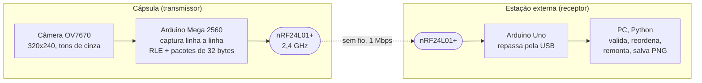
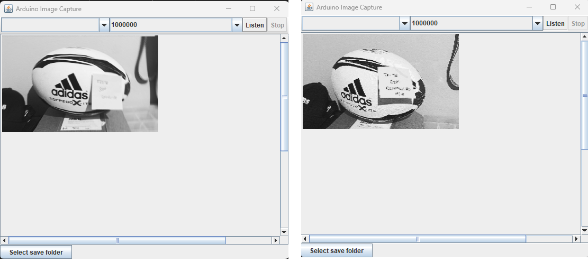
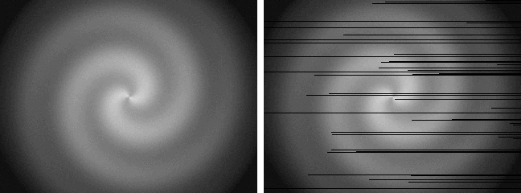

# Cápsula endoscópica sem fio: prova de conceito do sistema de imagem

**Trabalho de Conclusão de Curso, Engenharia de Controle e Automação, UFRGS (2025)**
*Validação de Conceito para Sistema de Transmissão de Imagens para Cápsula Endoscópica sem Fios*


Construí em bancada um protótipo que faz o caminho completo da imagem numa
cápsula endoscópica: **capturar** com uma câmera CMOS, **comprimir**,
**transmitir sem fio** em pacotes pequenos e **reconstruir** a imagem do lado
de fora, medindo perdas, compressão e taxa de quadros. Tudo com hardware de
baixo custo, sob as mesmas restrições de memória, banda e energia de uma
cápsula real.

<p align="center">
  
</p>

> **English summary.** Bachelor's thesis (Control & Automation Engineering, UFRGS).
> A bench prototype of the imaging subsystem of a wireless capsule endoscope:
> an OV7670 CMOS camera read by an Arduino Mega, a custom packet protocol
> (sequence numbers, frame/line markers, CRC-8) sized for the 32-byte payload of
> the nRF24L01+ 2.4 GHz radio, optional run-length encoding, and a Python tool
> that reassembles frames despite lost, duplicated or reordered packets.
> Results: 97.4% packet delivery at 1 m and 94.1% at 3 m; RLE cut frame size by
> 34% and raised the frame rate by about 50%.

---

## Sumário

- [O problema](#o-problema)
- [O que foi construído](#o-que-foi-construído)
- [Como funciona, passo a passo](#como-funciona-passo-a-passo)
- [Resultados](#resultados)
- [Experimente sem hardware](#experimente-sem-hardware)
- [Montando o protótipo](#montando-o-protótipo)
- [Estrutura do repositório](#estrutura-do-repositório)
- [Competências aplicadas](#competências-aplicadas)
- [Limitações e próximos passos](#limitações-e-próximos-passos)
- [Monografia, autoria e créditos](#monografia-autoria-e-créditos)

---

## O problema

Na **endoscopia por cápsula**, o paciente engole uma cápsula do tamanho de um
comprimido que fotografa o trato digestivo e envia as imagens sem fio para um
gravador preso ao corpo. É indolor, dispensa sedação e chega ao intestino
delgado, onde o endoscópio tradicional não alcança.

O difícil é caber tudo num volume minúsculo:

* **Energia:** a bateria é pequena. Imagens melhores e funções extras exigem
  mais energia do que ela fornece, por isso a pesquisa caminha para a
  **transferência de energia sem fio** por acoplamento indutivo. Este
  trabalho continua um estudo anterior do grupo sobre esse tema.
* **Banda:** o rádio precisa ser de baixo consumo, então transmite pouco.
  Comprimir e empacotar bem os dados é tão importante quanto a câmera.
* **Processamento:** um microcontrolador pequeno não guarda uma imagem
  inteira na memória e não roda algoritmos pesados.

Este TCC valida, em bancada, se a cadeia **câmera → microcontrolador →
rádio → reconstrução** funciona sob essas restrições, e quanto uma compressão
simples ajuda.

## O que foi construído



| Bloco | Componente | Por que este |
|---|---|---|
| Sensor | OV7670 (CMOS, VGA, barramento paralelo de 8 bits) | Barato, configurável por I2C, com a mesma interface (DVP) dos sensores de cápsulas |
| Processamento | Arduino Mega 2560 (8 kB de RAM) | Pinos suficientes para câmera e rádio ao mesmo tempo, com memória bem limitada, como numa cápsula |
| Rádio | nRF24L01+ (2,4 GHz, até 2 Mbps) | Baixo consumo, com CRC, confirmação (ACK) e retransmissão por hardware |
| Receptor | Arduino Uno + PC | O processamento pesado fica fora do corpo, como no gravador de uma cápsula real |

## Como funciona, passo a passo

**1. Capturar só o que importa.** A câmera opera em QVGA (320×240) no formato
YUV422, e o firmware guarda só a **luminância (Y)**, a parte em tons de cinza.
Isso corta pela metade o volume de dados e preserva o que interessa para ver
estruturas. São 76.800 bytes por imagem.

**2. Trabalhar linha a linha.** Uma imagem tem 76,8 kB e o Mega tem 8 kB de RAM.
Então o firmware lê **uma linha**, envia e só depois lê a próxima. Como o rádio
é mais lento que a câmera, interrupções nos sinais de sincronismo (VSYNC/HREF)
contam as linhas que passam durante o envio, e as linhas puladas são pegas nos
quadros seguintes da câmera. A captura nunca perde o sincronismo, mesmo quando
o rádio precisa retransmitir.

**3. Comprimir quando compensa (RLE).** O *Run-Length Encoding* troca
sequências de pixels iguais por pares `(quantidade, valor)`: `200 200 200 200
57` vira `(4, 200) (1, 57)`. É simples, sem perdas e cabe num microcontrolador
de 8 bits. Em cenas ruidosas o RLE pode **aumentar** o tamanho, então o
firmware decide **linha a linha** se envia comprimido ou bruto.

**4. Empacotar para o rádio.** O nRF24L01+ transporta no máximo 32 bytes por
pacote. Cada pacote leva 4 bytes de cabeçalho e 28 de dados:

```
| flags (início/fim de quadro e de linha) + nº de sequência (12 bits) | id do quadro | CRC-8 | 28 bytes de imagem |
```

Cada linha começa num pacote novo, identificada pelo seu número. Se um
pacote se perder, só um trecho daquela linha fica faltando, e o resto da
imagem continua no lugar. Especificação completa: [`docs/protocolo.md`](docs/protocolo.md).

**5. Reconstruir do lado de fora.** O Uno repassa os pacotes para o PC, onde
um programa em Python confere o CRC, ordena pelo número de sequência, descarta
duplicados, desfaz o RLE e salva cada imagem em PNG, com estatísticas de
entrega.

## Resultados

A validação foi feita em quatro etapas, isolando uma variável de cada vez:

| Etapa | O que foi testado | Resultado |
|---|---|---|
| 1. Dados brutos pela serial | leitura da câmera, sem protocolo nem rádio | imagens íntegras; a serial limitava a ~1,55 s por quadro |
| 2. Protocolo pela serial | empacotamento, perdas e reordenação artificiais | quadros reconstruídos com até **5% de perda**, só com falhas localizadas |
| 3. Enlace sem fio | nRF24L01+ a 1 Mbps, 1 m e 3 m | **97,4%** de pacotes entregues a 1 m e **94,1%** a 3 m |
| 4. Compressão RLE | o mesmo enlace, com e sem RLE | quadros **34,4% menores** e **+50,8%** na taxa de quadros |

| Parâmetro (médias) | Sem compressão | Com RLE | Variação |
|---|---:|---:|---:|
| Tamanho por quadro | 76.800 bytes | 50.400 bytes | −34,4% |
| Pacotes entregues | 97,4% | 96,8% | −0,6 p.p. |

Com o RLE, a taxa de quadros subiu **50,8%** e o tempo de transmissão por
quadro caiu **31%**, quase sem afetar a entrega de pacotes. O ganho depende
da cena: de 30% a 40% em regiões homogêneas e cerca de 15% em cenas
ruidosas ou muito detalhadas.



*Imagens reconstruídas sem compressão (esquerda) e com RLE (direita).
Fonte: monografia, Capítulo 4.*

## Experimente sem hardware

O software de PC tem um **simulador** que gera exatamente os bytes que o
receptor enviaria, inclusive com perdas, duplicações e reordenação de
pacotes. Só precisa do Python 3.9+, sem bibliotecas extras:

```bash
cd software
```

```bash
python -m capsula.simular --saida demo.bin --quadros 2 --perda 0.03 --duplicar 0.005 --reordenar 0.01
```

```bash
python -m capsula.receber --arquivo demo.bin --saida capturas-demo
```

```
Quadro   0: 1736/1782 pacotes (97.4%), linhas 200 completas / 31 parciais / 9 faltantes, RLE em 231 linhas (39.8% menor), 8 duplicados -> quadro_0001.png
```



*À esquerda, a imagem sintética original. À direita, a mesma imagem remontada
após 3% de perda de pacotes: só os trechos perdidos ficam pretos, o resto da
imagem continua no lugar.*

Os testes automatizados cobrem o CRC, o RLE, o formato dos pacotes e a
remontagem com perdas: `python -m unittest discover -s tests`.

## Montando o protótipo

Material: Arduino Mega 2560, Arduino Uno, câmera OV7670 (sem FIFO), dois
nRF24L01+, quatro resistores e quatro capacitores. A lista completa e as
tabelas de ligação estão em [`docs/hardware.md`](docs/hardware.md).

1. Grave [`firmware/diagnostico_camera`](firmware/diagnostico_camera) no Mega
   e confirme que a câmera, os sinais de sincronismo e os 8 bits de dados
   estão OK.
2. Valide o rádio com [`teste_radio_emissor`](firmware/teste_radio_emissor) e
   [`teste_radio_receptor`](firmware/teste_radio_receptor).
3. Grave [`transmissor_capsula`](firmware/transmissor_capsula) no Mega e
   [`receptor_base`](firmware/receptor_base) no Uno.
4. No PC: `python -m capsula.receber --porta COM5` (a porta do Uno).

Detalhes, opções e a correspondência com as etapas do TCC: [`firmware/README.md`](firmware/README.md).

## Estrutura do repositório

```
├── docs/
│   ├── monografia-tcc2.pdf      monografia final (TCC II)
│   ├── proposta-tcc1.pdf        proposta (TCC I)
│   ├── hardware.md              lista de materiais e ligações
│   ├── protocolo.md             especificação do protocolo de pacotes
│   └── imagens/
├── firmware/                    sketches Arduino
│   ├── transmissor_capsula/     Mega: câmera + RLE + pacotes + rádio
│   ├── receptor_base/           Uno: rádio -> USB
│   ├── diagnostico_camera/      Mega: checa cada sinal da câmera
│   └── teste_radio_*/           mede a qualidade do enlace
├── software/                    Python: recepção, remontagem, simulador e testes
├── monografia/                  fonte LaTeX da monografia (modelo UFRGS)
└── experimentos/                capturas iniciais da câmera e o que elas ensinaram
```

## Competências aplicadas

* **Sistemas embarcados:** leitura de um barramento paralelo de câmera por
  registradores (sem `digitalRead`), interrupções externas, temporizadores
  para gerar o clock de 8 MHz, I2C/SCCB e SPI em AVR com 8 kB de RAM.
* **Comunicação de dados:** protocolo de aplicação sobre um enlace de 32 bytes,
  com numeração, delimitação de quadros e linhas, CRC-8, tolerância a perda,
  duplicação e reordenação.
* **Compressão:** RLE adaptativo por linha, com análise de quando comprime e
  quando expande.
* **Eletrônica:** adaptação de níveis 5 V / 3,3 V, pull-ups de I2C,
  desacoplamento de rádio e diagnóstico de fiação.
* **Software e testes:** ferramenta em Python sem dependências pesadas,
  simulador do canal e testes unitários.
* **Método experimental:** validação em etapas isolando variáveis, com
  métricas de entrega, vazão e taxa de compressão.
* **Comunicação técnica:** monografia em LaTeX (ABNT) e documentação.

## Limitações e próximos passos

* **Banda:** a vazão do nRF24L01+ limita a taxa de quadros. Uma cápsula real
  usaria a banda MICS (402–405 MHz), que penetra melhor no tecido.
* **Compressão:** o RLE é simples. Os próximos candidatos são DPCM, JPEG-LS
  ou wavelets leves, em microcontroladores ARM Cortex-M4/M7.
* **Protocolo:** retransmissão seletiva de linhas perdidas (hoje, uma perda
  só é corrigida no quadro seguinte).
* **Integração:** miniaturização, estudo energético detalhado, antenas e
  acoplamento com o sistema de **transferência de energia sem fio** da
  cápsula.

## Monografia, autoria e créditos

* Monografia completa: [`docs/monografia-tcc2.pdf`](docs/monografia-tcc2.pdf)
  ([fonte LaTeX](monografia/)) e proposta: [`docs/proposta-tcc1.pdf`](docs/proposta-tcc1.pdf).
* **Autor:** Leonardo da Motta da Silva ([GitHub](https://github.com/MottaGit))
  <!-- Adicione aqui o link do seu LinkedIn: [LinkedIn](https://www.linkedin.com/in/SEU-PERFIL) -->
* **Orientador:** Prof. Dr. Valner João Brusamarello. Escola de Engenharia,
  Universidade Federal do Rio Grande do Sul (UFRGS).

Projetos de terceiros usados no desenvolvimento:

* [LiveOV7670](https://github.com/indrekluuk/LiveOV7670), de Indrek Luuk: driver
  de configuração da OV7670 (subconjunto incluído no firmware) e referência de
  leitura da câmera.
* [ArduImageCapture](https://github.com/indrekluuk/ArduImageCapture), de Indrek
  Luuk: visualizador Java usado durante os experimentos.
* [RF24](https://github.com/nRF24/RF24), de TMRh20 e colaboradores: driver do
  nRF24L01+.
* Classe LaTeX `ufrgscca`, de Alceu Frigeri: modelo da monografia.
