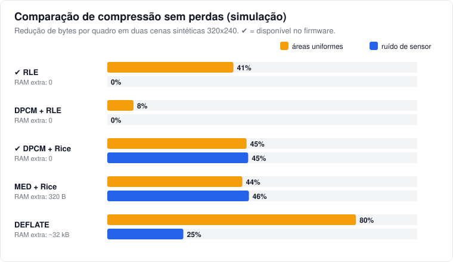

# Compressão sem perdas na cápsula

No TCC, a compressão escolhida foi o RLE (Etapa 4). Em bancada ele reduziu
os quadros em 34,4% e aumentou a taxa de quadros em 50,8%. Este documento
compara o RLE com outros algoritmos sem perdas que cabem num
microcontrolador, usando o mesmo protocolo de pacotes.



## Algoritmos

| Algoritmo | Ideia | RAM extra | No firmware |
|---|---|---:|:---:|
| RLE | sequências iguais viram `(repetições, valor)` | 0 | ✔ |
| DPCM + RLE | RLE sobre a diferença entre vizinhos | 0 | |
| **DPCM + Rice** | diferença entre vizinhos + código de Golomb-Rice com `k` por linha | 0 | ✔ |
| MED + Rice | preditor do JPEG-LS (usa a linha de cima) + Golomb-Rice | 320 B | |
| DEFLATE | zlib no quadro inteiro, como referência de PC | ~32 kB | |

Como funciona o DPCM + Rice ([`rice.py`](../software/capsula/rice.py), [`protocolo.cpp`](../firmware/transmissor_capsula/protocolo.cpp)):

1. cada pixel vira a diferença para o vizinho da esquerda. Em imagens
   naturais as diferenças são pequenas mesmo com ruído;
2. o mapeamento zigue-zague transforma 0, −1, 1, −2, … em 0, 1, 2, 3, …;
3. cada valor `v` é escrito como `v >> k` em unário seguido dos `k` bits
   baixos. O `k` de cada linha sai da regra do LOCO-I (menor `k` com
   `N·2^k ≥ soma`), calculada em uma passada.

O MED, preditor do JPEG-LS, precisaria da linha de cima. Isso não combina com
a captura entrelaçada do firmware, em que linhas vizinhas chegam em quadros
diferentes. Além disso, ele não ganhou do DPCM nos testes.

## Método

* Duas cenas sintéticas de 320×240. A primeira tem **áreas uniformes**: níveis
  quantizados, resultando em ~40% de redução com RLE, próximo do medido na
  Etapa 4. A segunda tem **ruído de sensor**, com desvio-padrão de 2,5 níveis
  e sem quantização.
* A regra é a mesma do firmware: cada linha vai codificada só se ficar menor
  que a bruta, com 2 bytes de cabeçalho de linha e 28 bytes por pacote.
* O ganho de FPS é estimado pelo número de pacotes, já que o rádio é o
  gargalo.

As imagens reais da monografia não servem para esta medida. Elas são
capturas de tela reduzidas, e a interpolação apaga as repetições.

## Resultados (`python -m capsula.compressao`)

**Áreas uniformes**

| Algoritmo | Bytes/quadro | Redução | Pacotes/quadro | FPS estimado |
|---|---:|---:|---:|---:|
| Bruto | 76.800 | 0% | 2.880 | — |
| RLE | 45.548 | 40,7% | 1.753 | +64% |
| DPCM + RLE | 70.300 | 8,5% | 2.645 | +9% |
| DPCM + Rice | 42.284 | 44,9% | 1.644 | +75% |
| MED + Rice | 43.332 | 43,6% | 1.678 | +72% |
| DEFLATE | 15.176 | 80,2% | 542 | (PC) |

**Ruído de sensor**

| Algoritmo | Bytes/quadro | Redução | Pacotes/quadro | FPS estimado |
|---|---:|---:|---:|---:|
| Bruto | 76.800 | 0% | 2.880 | — |
| RLE | 76.800 | 0% | 2.880 | +0% |
| DPCM + RLE | 76.800 | 0% | 2.880 | +0% |
| DPCM + Rice | 41.881 | 45,5% | 1.680 | +71% |
| MED + Rice | 41.713 | 45,7% | 1.680 | +71% |
| DEFLATE | 57.954 | 24,5% | 2.070 | (PC) |

## Conclusões

* O **RLE depende da cena**: rende em áreas uniformes e não rende nada com
  ruído. Isso bate com o observado no TCC (30–40% em cenas homogêneas, ~15% em
  cenas ruidosas).
* O **DPCM + Rice é estável (~45%)** nos dois casos, sem RAM extra e com custo
  linear. É o melhor candidato para o microcontrolador.
* O DEFLATE só vence em cenas muito uniformes e exige ~32 kB de RAM, quatro
  vezes a memória do Mega.

## No firmware

```c
// firmware/transmissor_capsula/config.h
#define COMPRESSAO COMP_RICE   // cada linha vai como bruto, RLE ou Rice, o que for menor
```

O software de PC decodifica automaticamente, porque a codificação vai no
cabeçalho de cada linha. Para simular sem hardware:

```bash
python -m capsula.simular --saida rice.bin --compressao rice --ruido 2.5
```

```bash
python -m capsula.receber --arquivo rice.bin
```
