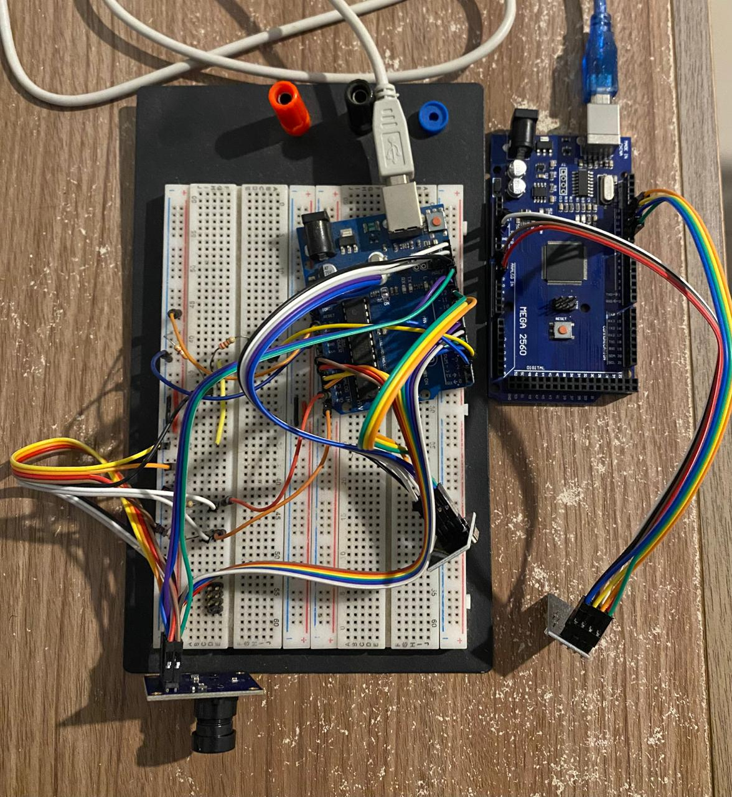

# Hardware: lista de materiais e ligações

Protótipo de bancada: não houve preocupação com miniaturização, só com
reproduzir as mesmas restrições de uma cápsula real (pouca memória, pouca
banda de rádio, consumo baixo).

## Lista de materiais

| Qtd. | Item | Função |
|---:|---|---|
| 1 | Arduino Mega 2560 | Transmissor ("cápsula"): lê a câmera, empacota e transmite |
| 1 | Arduino Uno (ou Nano) | Receptor ("estação externa"): repassa os pacotes ao PC pela USB |
| 1 | Módulo câmera OV7670 **sem FIFO** | Sensor CMOS, VGA, barramento paralelo de 8 bits |
| 2 | Módulo nRF24L01+ (antena impressa) | Rádio de 2,4 GHz, payload de 32 bytes, CRC e ACK por hardware |
| 2 | Resistor 4,7 kΩ | Divisor do XCLK (5 V para ~2,5 V) |
| 2 | Resistor 10 kΩ | Pull-ups do I2C/SCCB da câmera (para 3,3 V) |
| 2 + 2 | Capacitores 10 µF + 100 nF | Desacoplamento na alimentação de cada nRF24L01+ |
| — | Protoboard, jumpers curtos, 2 cabos USB | |

> A câmera e os rádios são de **3,3 V**. Os pinos de dados de saída da
> OV7670 (D0–D7, VSYNC, HREF, PCLK) podem ir direto ao Arduino, porque 3,3 V
> já é lido como nível alto. O que sai do Arduino para a câmera (XCLK) precisa
> ser reduzido.

## Transmissor: Arduino Mega 2560

O firmware lê a câmera direto nos registradores das portas, então **os pinos
são fixos**: D0–D7 precisam estar todos na porta A (pinos 22–29) para serem
lidos de uma vez, e VSYNC/HREF precisam estar em pinos com interrupção externa.

### Câmera OV7670

| OV7670 | Mega 2560 | Observação |
|---|---|---|
| 3V3 | 3.3V | |
| GND | GND | |
| SIOC | 21 (SCL) | pull-up de 10 kΩ para 3,3 V |
| SIOD | 20 (SDA) | pull-up de 10 kΩ para 3,3 V |
| VSYNC | 2 | início de quadro (INT4) |
| HREF | 3 | linha válida (INT5) |
| PCLK | 12 | clock de pixel (PB6) |
| XCLK | 9 | 8 MHz gerados pelo Timer2, **via divisor 4,7 kΩ / 4,7 kΩ** |
| D0 … D7 | 22 … 29 | porta A: D0→22, D1→23, …, D7→29 |
| RESET | 3.3V | mantém a câmera ativa |
| PWDN | GND | mantém a câmera ligada |

### Rádio nRF24L01+

| nRF24L01+ | Mega 2560 | Observação |
|---|---|---|
| VCC | 3.3V | 10 µF + 100 nF bem perto do módulo |
| GND | GND | |
| CE | 48 | |
| CSN | 53 | |
| SCK | 52 | SPI |
| MOSI | 51 | SPI |
| MISO | 50 | SPI |
| IRQ | sem ligação | é uma saída do módulo; não ligue ao GND |

## Receptor: Arduino Uno

| nRF24L01+ | Uno | Observação |
|---|---|---|
| VCC | 3.3V | 10 µF + 100 nF bem perto do módulo |
| GND | GND | |
| CE | 9 | |
| CSN | 10 | |
| SCK | 13 | SPI |
| MOSI | 11 | SPI |
| MISO | 12 | SPI |
| IRQ | sem ligação | |

## Por que o Mega na cápsula e o Uno no receptor?

* **Pinos:** no Uno, a ligação clássica da OV7670 ocupa os pinos 11, 12 e 13
  (XCLK e dados), que são justamente os pinos de SPI do rádio. No Mega, a
  câmera usa a porta A inteira e o SPI fica livre nos pinos 50–52.
* **Memória:** o Mega tem 8 kB de RAM (o Uno tem 2 kB). Mesmo assim, um quadro
  QVGA em tons de cinza tem 76,8 kB, por isso o processamento é feito
  **linha a linha**, nunca com o quadro inteiro na memória.
* **Receptor simples:** o Uno só repassa pacotes do rádio para a USB. A
  remontagem, que é a parte pesada, fica no PC, como numa cápsula real, em que
  o processamento fica no gravador externo.

## Cuidados que fazem diferença

* **XCLK:** o Arduino gera 5 V. O divisor de 4,7 kΩ + 4,7 kΩ entrega ~2,5 V,
  suficiente para a câmera reconhecer o clock sem forçar a entrada.
* **I2C/SCCB:** o Mega R3 já tem resistores de 10 kΩ para 5 V no SDA/SCL.
  Somados aos de 10 kΩ para 3,3 V, a linha fica em ~4,1 V em repouso. Para uma
  versão definitiva, use um conversor de nível I2C (ex.: módulo com BSS138).
* **Alimentação do nRF24L01+:** picos de corrente na transmissão derrubam a
  tensão e causam perdas que parecem "problema de alcance". Os capacitores de
  desacoplamento e a potência `RF24_PA_LOW` evitam isso.
* **Fios curtos:** PCLK e D0–D7 carregam sinais de centenas de kHz. Jumpers
  longos na protoboard causam bits trocados.

## Diferenças em relação ao diagrama da monografia

O diagrama em [`monografia/figuras/hardware.png`](../monografia/figuras/hardware.png)
foi mantido como estava na monografia entregue. Ele mostra a ligação genérica
"Uno/Mega" da câmera, que segue o esquema clássico do Uno. Também tem erros na
parte do rádio: MOSI/MISO em D13/D12 sem SCK, CE/CSN em D14/D15 e IRQ no GND.
As tabelas acima são a ligação correta para o firmware deste repositório. O
sketch [`diagnostico_camera`](../firmware/diagnostico_camera) confere cada
sinal da câmera antes de rodar o transmissor.
