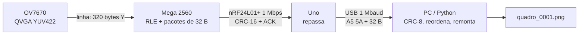

# Protocolo de transmissão de imagens

Especificação do protocolo lógico usado entre a cápsula (transmissor), o
receptor e o PC. Duas implementações seguem este documento e precisam
continuar idênticas:

* firmware: [`firmware/transmissor_capsula/protocolo.cpp`](../firmware/transmissor_capsula/protocolo.cpp)
* PC (referência, com testes): [`software/capsula/protocolo.py`](../software/capsula/protocolo.py)

## Visão geral



O nRF24L01+ já garante, por hardware, a integridade de **cada pacote** (CRC
de 16 bits, confirmação e retransmissão automáticas). Ele não sabe nada de
imagens. O protocolo abaixo é a camada de aplicação: numera os pacotes,
delimita linhas e quadros e permite remontar a imagem mesmo com perdas.

## Pacote (32 bytes)

```
 byte 0          byte 1      byte 2        byte 3     bytes 4..31
+---------------+-----------+-------------+----------+----------------+
| flags | seq_h |   seq_l   |  id quadro  |  CRC-8   |  payload (28)  |
+---------------+-----------+-------------+----------+----------------+
  4 bits  4 bits
```

| Campo | Tamanho | Descrição |
|---|---|---|
| flags | 4 bits | `SOF`=0x80 primeiro pacote da imagem, `EOF`=0x40 último, `SOL`=0x20 primeiro de uma linha, `EOL`=0x10 último de uma linha |
| seq | 12 bits | número de sequência dentro da imagem (0…4095), zera a cada imagem |
| id quadro | 8 bits | identificador da imagem, incrementa a cada imagem (dá a volta em 255) |
| CRC-8 | 8 bits | polinômio 0x07, valor inicial 0 (CRC-8/SMBUS), calculado sobre os bytes 0–2 e 4–31 |
| payload | 28 bytes | dados da linha (preenchido com zeros no último pacote) |

O CRC lógico protege também o trecho USB/serial, que não tem o CRC do
rádio. Ele é calculado também sobre o cabeçalho, para detectar um número de
sequência corrompido.

## Linhas

Cada linha começa **sempre em um pacote novo**, com flag `SOL`, e o payload
desse primeiro pacote começa com 2 bytes de cabeçalho de linha:

| Byte | Conteúdo |
|---|---|
| 0 | número da linha (0…239) |
| 1 | codificação: `0` = bruto, `1` = RLE |

Assim, uma perda afeta no máximo uma linha, e as linhas podem chegar em
qualquer ordem. O transmissor envia em ordem entrelaçada (ver abaixo).

* **Bruto:** os 320 bytes de luminância em sequência. São 26 bytes no primeiro
  pacote e 28 nos seguintes, ou seja, **12 pacotes por linha**. Como as
  posições são fixas, um pacote perdido no meio da linha só apaga aquele
  trecho de 28 pixels.
* **RLE:** pares `(repetições, valor)`, com repetições de 1 a 255. Um par
  nunca é dividido entre pacotes (13 pares no primeiro, 14 nos seguintes), e
  um par com repetições = 0 é preenchimento. O transmissor só usa RLE quando
  ele é **menor** que a linha bruta, então uma linha nunca passa de 12 pacotes
  e o pior caso (240 × 12 = 2.880 pacotes) cabe nos 12 bits de sequência.
  Depois de uma perda não dá para saber onde os pares seguintes começam,
  então o resto daquela linha fica marcado como faltante.

## Enquadramento na serial

O receptor envia cada pacote ao PC como `A5 5A` + 32 bytes, a 1.000.000
baud. O PC procura o `A5 5A`, valida o CRC-8 e, se ele falhar, recomeça a
procura um byte adiante. Texto solto na serial (mensagens de inicialização)
é ignorado.

## Remontagem no PC

1. Pacotes de uma mesma imagem (mesmo id) são guardados por número de
   sequência. Chegar fora de ordem não é problema, e duplicados são ignorados.
2. A imagem é entregue quando chega o `EOF` e todos os pacotes até ele, ou,
   se houve perdas, quando começa a próxima imagem (ou após um tempo sem
   pacotes).
3. Para cada pacote `SOL`, os pacotes seguintes são lidos até o `EOL` e a
   linha é decodificada. Linhas e trechos perdidos ficam pretos (padrão,
   útil para depuração) ou repetem o quadro anterior (`--faltantes anterior`).
4. Estatísticas por imagem: pacotes recebidos/esperados (o `seq` do `EOF`
   informa o total), linhas completas/parciais/faltantes e redução pelo RLE.

## Estratégia de captura no transmissor

O Mega não tem RAM para um quadro inteiro, e o rádio (~0,7 ms por pacote com
ACK) é mais lento que a câmera. O firmware então:

1. lê **uma** linha (320 bytes de Y) assim que o HREF sobe, com as
   interrupções desligadas para não perder nenhuma borda do PCLK;
2. envia essa linha (12 pacotes ou menos, com RLE). Enquanto isso, as
   interrupções de HREF/VSYNC continuam contando as linhas que passam;
3. ao terminar, espera a próxima linha **ainda não enviada** e repete.

As linhas puladas são capturadas nos próximos quadros da câmera. Na prática,
a imagem é montada de forma entrelaçada (0, 4, 8, … depois 1, 5, 9, …) e o
tempo por imagem fica limitado pelo rádio, não pela câmera. Por isso o RLE
(menos pacotes por linha) se traduz direto em mais quadros por segundo. Como
efeito colateral, objetos em movimento rápido aparecem "penteados", o que é
aceitável numa validação em bancada com cena estática.

## Vetores de teste

Para conferir uma implementação nova:

* `crc8("123456789") = 0xF4` (o transmissor verifica isso ao ligar);
* pacote `SOF|SOL`, seq 0, quadro 0, linha 0 bruta, dados `00 01 02 … 19`:

```
a0 00 00 97 00 00 00 01 02 03 04 05 06 07 08 09 0a 0b 0c 0d 0e 0f 10 11 12 13 14 15 16 17 18 19
```
