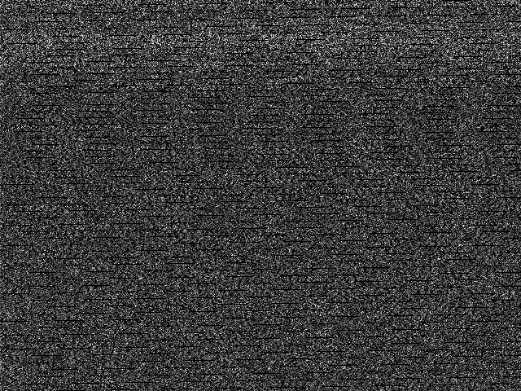

# Experimentos

## Capturas iniciais da câmera

Registros das primeiras tentativas de leitura da OV7670, antes da versão
final da captura. Foram mantidos porque mostram os problemas que levaram às
decisões de projeto.

| Arquivo | O que é |
|---|---|
| `capturas-iniciais/captura-ov7670-640x480-hex.txt` | despejo de um quadro VGA (307.200 bytes em hexadecimal) |
| `capturas-iniciais/captura-ov7670-640x480-hex.png` | o mesmo quadro convertido com `software/ferramentas/hex_para_png.py` |
| `capturas-iniciais/captura-ov7670-cores-trocadas.png` | captura colorida com os componentes de cor interpretados no formato errado |

O despejo em hexadecimal não contém imagem: é ruído com textura de linhas.
A ferramenta de conversão mostra que **o bit D0 está em 0 em todos os
307.200 bytes**, o que costuma indicar fio solto ou mal encaixado. Além
disso, o primeiro teste de câmera lia os pixels com `digitalRead`, que é
lento demais para acompanhar o PCLK. Esses dois problemas motivaram:

* a leitura direta da porta inteira de uma vez (`PINA` no Mega), em vez de
  bit a bit;
* o sketch [`firmware/diagnostico_camera`](../firmware/diagnostico_camera),
  que testa cada sinal e cada bit do barramento separadamente;
* o uso apenas da luminância (Y), que elimina o problema das cores trocadas
  e reduz o volume de dados pela metade.

## Resultados do TCC

Os resultados quantitativos (quatro etapas de validação) estão no
Capítulo 4 da [monografia](../docs/monografia-tcc2.pdf) e resumidos no
[README principal](../README.md#resultados).
