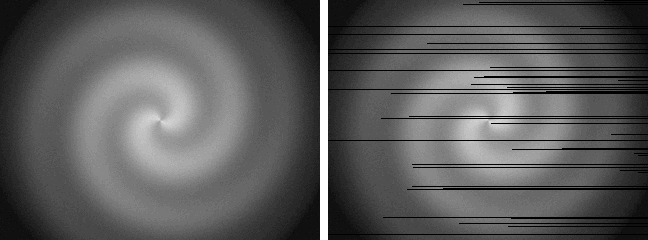

# Software de PC (Python)

Recebe os pacotes do receptor pela USB, valida o CRC-8, reordena, descarta
duplicados, desfaz o RLE e salva cada imagem em PNG, com estatísticas de
entrega por quadro. Inclui um **simulador** que gera o mesmo fluxo de bytes
sem nenhum hardware, inclusive com perdas, duplicações e reordenação
artificiais, como na Etapa 2 do TCC.

Não depende de nada além da biblioteca padrão do Python 3.9+. O `pyserial`
só é necessário para ler a porta serial ao vivo.

```bash
cd software
```

```bash
pip install -r requirements.txt
```

## Demonstração sem hardware

```bash
python -m capsula.simular --saida demo.bin --quadros 2 --perda 0.03 --duplicar 0.005 --reordenar 0.01
```

```bash
python -m capsula.receber --arquivo demo.bin --saida capturas-demo
```

Saída esperada (resumida):

```
Quadro   0: 1736/1782 pacotes (97.4%), linhas 200 completas / 31 parciais / 9 faltantes, RLE em 231 linhas (39.8% menor), 8 duplicados -> quadro_0001.png
```



Opções úteis do simulador: `--sem-rle`, `--ruido 3` (cena mais ruidosa, o
RLE rende menos), `--imagem foto.pgm` (usa uma imagem sua em PGM binário).

## Com o hardware

```bash
python -m capsula.receber --porta COM5
```

No Linux/macOS a porta é algo como `/dev/ttyACM0`. Opções:

| Opção | Efeito |
|---|---|
| `--saida pasta` | onde salvar os PNG (padrão: `capturas/`) |
| `--faltantes anterior` | linhas perdidas repetem o quadro anterior em vez de ficar pretas |
| `--gravar sessao.bin` | grava os bytes brutos para reprocessar depois com `--arquivo` |
| `--quadros N` | para depois de N imagens |
| `--baud` | velocidade da serial (padrão 1000000, igual ao receptor) |

## Ferramentas

* [`ferramentas/hex_para_png.py`](ferramentas/hex_para_png.py): converte um
  despejo hexadecimal da câmera em PNG e aponta bits de dados presos
  (foi usado na captura em [`experimentos/`](../experimentos)).

## Testes

```bash
python -m unittest discover -s tests -v
```

Os testes cobrem o CRC-8 (com o valor de verificação padrão), a
ida e volta do RLE, o formato dos pacotes (incluindo o vetor de
referência de [`docs/protocolo.md`](../docs/protocolo.md)), a
ressincronização da serial e a remontagem com perdas, duplicados e pacotes
fora de ordem.

## Organização

| Arquivo | Conteúdo |
|---|---|
| `capsula/protocolo.py` | formato do pacote, CRC-8, empacotador (igual ao firmware), leitor da serial |
| `capsula/rle.py` | codificação e decodificação RLE |
| `capsula/remontagem.py` | remontagem dos quadros e estatísticas |
| `capsula/receber.py` | linha de comando: serial/arquivo -> PNG |
| `capsula/simular.py` | linha de comando: gera um fluxo como o do receptor |
| `capsula/imagem.py` | PNG/PGM em tons de cinza sem dependências |
